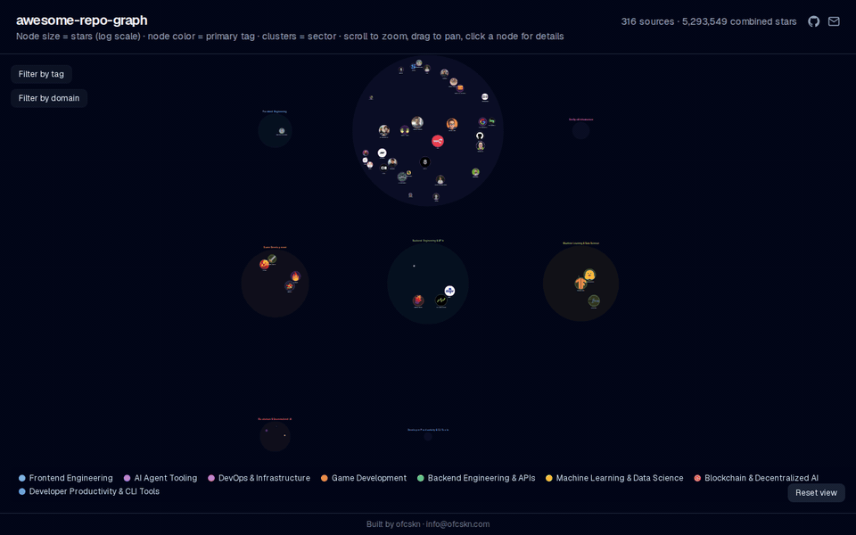

# awesome-repo-graph

  

A curated, structured collection of open-source repositories, grouped by sector and category, cross-linked by shared tags. `sources.json` is the single source of truth; this file and the graph visualization are both generated from it.

**[View the live graph →](https://ofcskn.github.io/awesome-repo-graph/)**



## Contents

- [Live demo](#view-the-live-graph)
- [How this repository works](#how-this-repository-works)
- [Adding a source](#adding-a-source)
- [Contributing securely (approved agents)](#contributing-securely-approved-agents)
- [Graph visualization](#graph-visualization)
- [Demo GIF](#demo-gif)
- [Sectors](#sectors)
- [Catalog](#catalog)
- [License](#license)

## How this repository works

- **`sources.json`** holds every tracked source: URL, provider, taxonomy `path`, tags, license, and GitHub star score.
- **This file (`README.MD`)** is generated from `sources.json` by `scripts/generate-readme.js` — do not edit it directly.
- **`AGENTS.MD`** documents the ruleset for adding sources correctly (dedup, taxonomy, tagging conventions) for both humans and AI agents.
- **`web/`** is a Next.js app that renders the same data as an interactive graph (node size = stars, edges = shared tags, clusters = sector).

## Adding a source

```
node scripts/add-source.js \
  --url "https://github.com/owner/repo" \
  --path "Sector>Category>Subcategory" \
  --tags tag-one,tag-two
```

This automatically rejects duplicates, detects the provider, fetches GitHub stars/license, and regenerates this README. See `AGENTS.MD` for full conventions. Refresh star counts periodically with:

```
node scripts/refresh-scores.js
```

## Contributing securely (approved agents)

Entries only enter `sources.json` through an **approved, verifiable agent**. A pull request that changes `sources.json` or `README.MD` must carry a cryptographic attestation, committed as `agent-attestation.json`, proving the change was produced by an agent listed in `agents/approved-agents.json`. The `approved-agent-gate` CI check re-validates the added entries against the mechanical policy and verifies the attestation's Ed25519 signature and content digests; a raw, hand-edited catalog change fails the check.

Only public keys live in the repository — signing keys are held as CI secrets or on an operator's machine and are never committed. See `docs/agent-gateway.md` for the trust model and how to become an approved agent.

## Graph visualization

The live version is deployed via GitHub Pages: **[https://ofcskn.github.io/awesome-repo-graph/](https://ofcskn.github.io/awesome-repo-graph/)**.

To run it locally instead:

```
cd web && npm install && npm run dev
```

Renders an interactive, GSAP-animated graph of every source at `localhost:3000` — circle size reflects star count, edges connect sources sharing tags.

## Demo GIF

The animated demo above (`assets/demo.gif`) is generated, not hand-made. On every push to `main`, a workflow builds the graph, drives it through a scripted scene (initial render → tag filter → zoom → inspect a node → settle) with a headless browser, and assembles the frames into an optimized looping GIF that is committed back — so the demo always reflects the current site.

To regenerate it locally:

```
cd web && npm ci && npm run build
cd ../tools/demo-capture && npm install && npx playwright install --with-deps chromium
npm run capture:demo
```

`ffmpeg` must be on your `PATH`. The scene and all tunables (frame rate, size, per-beat frame counts) live in `tools/demo-capture/scene.mjs`; see `docs/demo-capture.md` for details.

## Sectors

- **Frontend Engineering** — 12 sources
- **AI Agent Tooling** — 191 sources
- **DevOps & Infrastructure** — 1 source
- **Game Development** — 21 sources
- **Backend Engineering & APIs** — 24 sources
- **Machine Learning & Data Science** — 24 sources
- **Blockchain & Decentralized AI** — 46 sources
- **Developer Productivity & CLI Tools** — 1 source

## Catalog

<details>
<summary><strong>Frontend Engineering</strong> — 12 sources</summary>

### GSAP
#### GSAP Website Examples
- **[award-winning-website](https://github.com/adrianhajdin/award-winning-website)**  
  ★ 1,041 · `gsap` `landing-page`
- **[jsm_gta_vi_landing](https://github.com/adrianhajdin/jsm_gta_vi_landing)**  
  ★ 203 · `gsap` `landing-page`
- **[Truus.co-Awwward-Website](https://github.com/Thakuma07/Truus.co-Awwward-Website)** — Vanilla HTML/CSS/JS site built with GSAP, ScrollTrigger, and Lenis featuring experimental layout, cursor interaction, and dense motion design.  
  ★ 140 · `gsap` `landing-page` `scrolltrigger`
- **[3D-Landing-page-for-Apple-iPhone](https://github.com/codebucks27/3D-Landing-page-for-Apple-iPhone)** — 3D iPhone product landing page using Three.js for rendering and GSAP/ScrollTrigger for scroll-controlled camera and product animation.  
  ★ 108 · `gsap` `landing-page` `threejs` `scrolltrigger`
- **[capsule](https://github.com/ShowravKormokar/capsule)** — React, Vite, Tailwind, and GSAP recreation of the Awwwards-winning Capsule site's complex animations.  
  ★ 78 · `gsap` `landing-page` `tailwind`
- **[SpyltMilk-clone](https://github.com/ShowravKormokar/SpyltMilk-clone)** — Single-product Awwwards clone with bold, colorful motion design built with React, Tailwind, and GSAP.  
  ★ 45 · `gsap` `landing-page` `tailwind`
- **[svelte-gsap-template](https://github.com/YusufCeng1z/svelte-gsap-template)** — Production-oriented, MIT-licensed creative agency landing page template built with Svelte 5, GSAP 3, and Tailwind CSS 4, featuring spatial typography and hardware-accelerated motion.  
  ★ 37 · `gsap` `landing-page` `svelte` `tailwind`
- **[gentlerain.ai](https://github.com/manish-850/gentlerain.ai)** — Clone of the Gentlerain.ai Awwwards site built with GSAP, Three.js, and Lenis, showing WebGL and GSAP used together.  
  ★ 36 · `gsap` `landing-page` `threejs` `webgl`
- **[JeskoJets-ScrollAnimation](https://github.com/Thakuma07/JeskoJets-ScrollAnimation)** — Scroll animation that zooms into the hero area instead of sliding past it, for perspective and 3D transition effects.  
  ★ 21 · `gsap` `landing-page` `scrolltrigger`
- **[threejs-gsap-scroller](https://github.com/TranHuuDat2004/threejs-gsap-scroller)** — Isolated example binding a Three.js 3D object to a ScrollTrigger timeline for scroll-controlled camera movement and 3D scenes.  
  ★ 14 · MIT · `gsap` `landing-page` `threejs` `scrolltrigger`
- **[cocktails-gsap](https://github.com/rr3s1/cocktails-gsap)** — Scroll-driven landing page built with React, Tailwind, and GSAP, with a clean folder structure for studying advanced GSAP animations.  
  ★ 13 · `gsap` `landing-page` `tailwind`
- **[Magma_Landing-Page_Clone](https://github.com/vijita-u/Magma_Landing-Page_Clone)** — GSAP, ScrollTrigger, Locomotive Scroll, and HTML Canvas clone with scroll-driven canvas frame changes, zoom, and scene transitions.  
  ★ 2 · MIT · `gsap` `landing-page` `scrolltrigger` `canvas`

</details>

<details>
<summary><strong>AI Agent Tooling</strong> — 191 sources</summary>

### Security & Pentesting
- **[strix](https://github.com/usestrix/strix)** — Open-source AI-powered penetration testing agent that autonomously finds and fixes application vulnerabilities.  
  ★ 46,446 · Apache-2.0 · `ai-agent` `penetration-testing` `security` `python`

### Browser & GUI Agents
- **[chrome-devtools-mcp](https://github.com/ChromeDevTools/chrome-devtools-mcp)** — Official Chrome DevTools MCP server letting coding agents control and debug the browser directly.  
  ★ 48,338 · Apache-2.0 · `mcp-server` `chrome-devtools` `debugging` `typescript`
- **[page-agent](https://github.com/alibaba/page-agent)** — In-browser GUI agent from Alibaba that controls web interfaces via natural language.  
  ★ 28,348 · MIT · `ai-agent` `browser-automation` `gui-agent` `javascript`
- **[smolagents/computer-agent](https://huggingface.co/spaces/smolagents/computer-agent)** — A Hugging Face Space for an AI agent designed to interact with a computer, featuring a web-based graphical user interface built with Gradio.  
  `ai-agent` `gui-agent` `automation` `gradio`

### Terminal & CLI Agents
- **[gemini-cli](https://github.com/google-gemini/gemini-cli)** — An open-source AI agent that integrates Google Gemini capabilities into the command-line interface.  
  ★ 106,295 · Apache-2.0 · `ai-agent` `cli` `terminal` `mcp-server` `typescript` `gemini`
- **[herdr](https://github.com/ogulcancelik/herdr)** — High-performance Rust-based terminal multiplexer for running multiple AI agents at once.  
  ★ 23,360 · Apache-2.0 · `terminal-multiplexer` `ai-agent` `rust`
- **[agents-cli](https://github.com/google/agents-cli)** — Official Google CLI and skill pack specializing any coding assistant in building, evaluating, and deploying AI agents on Google Cloud.  
  ★ 5,445 · Apache-2.0 · `google-cloud` `agent-development-kit` `cli`

### MCP Servers
- **[unity-mcp](https://github.com/CoplayDev/unity-mcp)** — Bridges AI assistants with the Unity Editor to automate scene control and asset management.  
  ★ 13,047 · MIT · `mcp-server` `unity` `game-development`
- **[gitlab-mcp](https://gitlab.com/fforster/gitlab-mcp)** — A server implementation for the Model Context Protocol (MCP) integrated with GitLab.  
  `mcp` `mcp-server` `ai-agent` `ai`
- **[Graphify](https://huggingface.co/spaces/Agents-MCP-Hackathon/Graphify)** — A project from the Agents-MCP-Hackathon, identified as an MCP server, likely featuring a Gradio interface.  
  `gradio` `mcp-server` `ai-agent` `hackathon`

### Local AI Tools
- **[terax-ai](https://github.com/crynta/terax-ai)** — A 7MB terminal-first local AI development workspace.  
  ★ 8,782 · Apache-2.0 · `local-ai` `terminal` `lightweight`

### Claude Code Skills
- **[caveman](https://github.com/JuliusBrussee/caveman)** — Claude Code skill that reduces token usage by up to 65% via compressed, cavemen-style context.  
  ★ 95,101 · MIT · `claude-code` `skill` `token-optimization` `javascript`

### Claude Code Plugins
- **[codex-plugin-cc](https://github.com/openai/codex-plugin-cc)** — Plugin that runs OpenAI Codex from within Claude Code, bridging two agent systems for delegation and review.  
  ★ 30,863 · Apache-2.0 · `claude-code` `codex` `plugin` `agent-delegation`
- **[harness](https://github.com/revfactory/harness)** — Meta-skill plugin for Claude Code that designs domain-specific agent teams by architecture pattern and generates the skills they use.  
  ★ 8,577 · Apache-2.0 · `claude-code` `agent-teams` `skills` `meta-skill`

### Agent Harness
- **[ECC](https://github.com/affaan-m/ECC)** — Agent performance optimization system for Claude Code, Codex, and Cursor providing skills, instincts, and memory management.  
  ★ 236,837 · MIT · `agent-harness` `skills` `memory` `claude-code` `codex` `cursor`

### Video
- **[video-use](https://github.com/browser-use/video-use)** — Automates video editing workflows using browser-use-powered coding agents.  
  ★ 18,254 · MIT · `video-editing` `browser-use` `automation`

### Agent Apps
- **[anything-llm](https://github.com/Mintplex-Labs/anything-llm)** — AnythingLLM is a self-hosted, local-first platform for building and managing AI agents. It supports large language models, Retrieval Augmented Generation (RAG), multimodal capabilities, and integrates with vector databases.  
  ★ 64,209 · MIT · `ai-agent` `llm` `local-ai` `self-hosted` `rag` `javascript`
- **[career-ops](https://github.com/santifer/career-ops)** — Go-based AI-powered job search system built on Claude Code with a dashboard and 14 skill modes.  
  ★ 62,474 · MIT · `job-search` `dashboard` `go` `ai-agent`
- **[lenserfight](https://github.com/conectlens/lenserfight)** — Platform for parameterized prompts, AI-agent workflows, a community forum, and prompt battles.  
  ★ 15 · MIT · `ai-agent` `prompt-engineering` `workflow-automation` `automation`

### Agent Frameworks
- **[openclaw](https://github.com/openclaw/openclaw)**  
  ★ 384,846 · NOASSERTION · `ai-agent` `agent-framework`
- **[superpowers](https://github.com/obra/superpowers)** — Agentic skill framework and software development methodology.  
  ★ 264,794 · MIT · `agent-framework` `skills` `software-development-methodology`
- **[hermes-agent](https://github.com/NousResearch/hermes-agent)** — Extensible AI agent with persistent memory designed to adapt to its user over time.  
  ★ 223,834 · MIT · `ai-agent` `agent-framework` `llm` `memory`
- **[agency-agents](https://github.com/msitarzewski/agency-agents)** — End-to-end AI agency framework composed of specialized expert agents (frontend, community management, etc.).  
  ★ 138,049 · MIT · `agent-framework` `multi-agent` `frontend` `community-management`
- **[ai-berkshire](https://github.com/xbtlin/ai-berkshire)** — Value-investing research framework for Claude Code and Codex combining multiple investor methodologies via a multi-agent architecture.  
  ★ 14,856 · MIT · `claude-code` `codex` `value-investing` `multi-agent`
- **[codec](https://github.com/AVADSA25/codec)** — An open-source intelligent command layer and framework for building and running local AI agents, supporting voice interaction and self-hosted deployments.  
  ★ 102 · MIT · `ai-agent` `agent-framework` `local-ai` `self-hosted` `macos` `python`

### Agent Infrastructure
- **[OmniRoute](https://github.com/diegosouzapw/OmniRoute)** — Free AI gateway for coding assistants routing 200+ LLM providers through one endpoint, with token compression and MCP/A2A support.  
  ★ 37,055 · MIT · `llm-gateway` `mcp` `a2a` `token-compression`
- **[CubeSandbox](https://github.com/TencentCloud/CubeSandbox)** — Tencent Cloud's open-source sandbox for running AI agents in concurrent, secure, isolated environments.  
  ★ 10,814 · NOASSERTION · `sandbox` `agent-infrastructure` `tencent-cloud` `rust`
- **[agent-toolkit-for-aws](https://github.com/aws/agent-toolkit-for-aws)** — Officially supported MCP servers and plugin pack for AI coding agents to interact with AWS services.  
  ★ 2,196 · Apache-2.0 · `aws` `mcp` `agent-toolkit`

### Data Access & Research
- **[Agent-Reach](https://github.com/Panniantong/Agent-Reach)** — Capability layer giving AI agents zero-fee read/search access to Twitter, Reddit, YouTube, GitHub, and more.  
  ★ 63,979 · MIT · `ai-agent` `web-search` `social-media` `cli`
- **[hiring-agent](https://github.com/interviewstreet/hiring-agent)** — AI agent that autonomously reads, evaluates, and scores resumes for hiring workflows.  
  ★ 6,682 · MIT · `hiring` `resume-parsing` `ai-agent`

### Design & UI Generation
- **[ai-website-cloner-template](https://github.com/JCodesMore/ai-website-cloner-template)** — Template that uses AI coding agents to analyze and clone a website's design into a modern Next.js/Tailwind project.  
  ★ 30,783 · MIT · `nextjs` `tailwind` `website-cloning` `coding-agent`
- **[design.md](https://github.com/google-labs-code/design.md)** — Google Labs format for conveying design systems and visual identity to coding agents via combined YAML/Markdown files.  
  ★ 26,846 · Apache-2.0 · `design-system` `yaml` `coding-agent` `ui-generation`
- **[openpencil](https://github.com/ZSeven-W/openpencil)** — Open-source AI vector design tool turning natural-language prompts into UI designs, with code output for React, Tailwind, Flutter, and SwiftUI.  
  ★ 4,521 · MIT · `design-as-code` `vector-design` `ui-generation` `multi-agent`

### Data & Document Processing
- **[MinerU](https://github.com/opendatalab/MinerU)** — Document parsing engine converting PDF/DOCX/PPTX into Markdown/JSON for RAG and agent workflows, with VLM/OCR support.  
  ★ 76,468 · NOASSERTION · `document-parsing` `rag` `ocr` `pdf`

### Multi-Agent Research
- **[awesome-multi-agent-papers](https://github.com/kyegomez/awesome-multi-agent-papers)** — A curated list of notable research papers on multi-agent LLM systems, maintained by kyegomez.  
  ★ 1,637 · NOASSERTION · `multi-agent` `llm` `ai-agent`

### Workflow Automation
- **[n8n](https://github.com/n8n-io/n8n)** — Fair-code workflow automation platform with native AI capabilities, 400+ integrations, and self-hosting.  
  ★ 198,984 · NOASSERTION · `workflow-automation` `automation` `low-code` `self-hosted`

### Agent Orchestration
#### Terminal & TUI
- **[cmux](https://github.com/manaflow-ai/cmux)** — Ghostty-based macOS terminal with vertical tabs and per-agent notifications, built for keeping many concurrent sessions legible.  
  ★ 25,419 · `ai-agent` `agent-orchestrator` `terminal-multiplexer` `swift`
- **[claude-squad](https://github.com/smtg-ai/claude-squad)** — Runs each agent as a detached background session with its own worktree, so work continues after you close the pane. Claude Code, Codex, OpenCode, Amp.  
  ★ 8,219 · AGPL-3.0 · `ai-agent` `agent-orchestrator` `terminal-multiplexer` `go`
- **[agent-of-empires](https://github.com/agent-of-empires/agent-of-empires)** — Pairs a TUI with a matching web view, so the same sessions stay reachable from a phone. Claude Code, Codex, OpenCode, Gemini, Mistral Vibe.  
  ★ 2,918 · MIT · `ai-agent` `agent-orchestrator` `terminal-multiplexer` `rust`
- **[dmux](https://github.com/standardagents/dmux)** — Dev agent multiplexer pairing coding agents with git worktrees over tmux.  
  ★ 1,720 · MIT · `ai-agent` `agent-orchestrator` `terminal-multiplexer` `html`
- **[agent-deck](https://github.com/asheshgoplani/agent-deck)** — One TUI covering sessions across Claude Code, Codex, Gemini, and OpenCode, with live status and resume for each.  
  ★ 639 · MIT · `ai-agent` `agent-orchestrator` `terminal-multiplexer` `go`
- **[tmux-ide](https://github.com/wavyrai/tmux-ide)** — Turns any project into a tmux IDE from a checked-in `ide.yml`, including preset agent-team layouts.  
  ★ 534 · MIT · `ai-agent` `agent-orchestrator` `terminal-multiplexer` `typescript`
- **[agterm](https://github.com/umputun/agterm)** — Native macOS terminal with named workspaces, a live dashboard, attention states, and a scriptable control API.  
  ★ 388 · MIT · `ai-agent` `agent-orchestrator` `terminal-multiplexer` `swift`
- **[agentbox](https://github.com/madarco/agentbox)** — Gives each agent its own sandboxed VM — local Docker or cloud via Hetzner, Daytona, Vercel, or E2B — with sub-second checkpoint starts.  
  ★ 329 · MIT · `ai-agent` `agent-orchestrator` `terminal-multiplexer` `typescript`
- **[amux](https://github.com/andyrewlee/amux)** — Minimal TUI for spawning parallel coding agents in git worktrees.  
  ★ 142 · MIT · `ai-agent` `agent-orchestrator` `terminal-multiplexer` `go`
- **[openkanban](https://github.com/TechDufus/openkanban)** — Kanban board for orchestrating coding agents, rendered entirely in the terminal.  
  ★ 129 · AGPL-3.0 · `ai-agent` `agent-orchestrator` `terminal-multiplexer` `go`
- **[thurbox](https://github.com/Thurbeen/thurbox)** — TUI orchestrator with remote SSH sessions, inter-session messaging, and a native code-review view. Works with any CLI agent you define.  
  ★ 42 · MIT · `ai-agent` `agent-orchestrator` `terminal-multiplexer` `rust`
- **[agent-console](https://github.com/buhuipao/agent-console)** — Rust TUI that finds Codex and Claude Code sessions from the providers' own transcripts, including ones started elsewhere, and resumes their native UI rather than replacing it. No tmux or worktrees.  
  ★ 10 · Apache-2.0 · `ai-agent` `agent-orchestrator` `terminal-multiplexer` `rust`
- **[repomon](https://github.com/AliHamzaAzam/repomon)** — Rust TUI that supervises a fleet across many repositories at once, in durable tmux sessions you can approve from your phone.  
  ★ 9 · Apache-2.0 · `ai-agent` `agent-orchestrator` `terminal-multiplexer` `rust`

#### Desktop & Web
- **[orca](https://github.com/stablyai/orca)** — Agentic development environment for running a fleet on your own subscription, available on desktop and mobile.  
  ★ 34,307 · MIT · `ai-agent` `agent-orchestrator` `agent-dashboard` `typescript`
- **[t3code](https://github.com/pingdotgg/t3code)** — Harness control surface available as web, mobile, and desktop app. Claude Code, Codex, Cursor, Grok Build, OpenCode.  
  ★ 15,991 · MIT · `ai-agent` `agent-orchestrator` `agent-dashboard` `typescript`
- **[Aperant](https://github.com/AndyMik90/Aperant)** — Runs up to 12 agent terminals with a self-validating QA loop and automatic conflict resolution when merging back to main.  
  ★ 14,496 · AGPL-3.0 · `ai-agent` `agent-orchestrator` `agent-dashboard` `typescript`
- **[superset](https://github.com/superset-sh/superset)** — Code editor built around running many agents on your machine at once.  
  ★ 12,712 · `ai-agent` `agent-orchestrator` `agent-dashboard` `typescript`
- **[humanlayer](https://github.com/humanlayer/humanlayer)** — Human-in-the-loop control for coding agents on hard problems; the repo notes its code is now largely deprecated in favor of a rebuild.  
  ★ 11,187 · `ai-agent` `agent-orchestrator` `agent-dashboard` `typescript`
- **[agent-orchestrator](https://github.com/Untrivial-ai/agent-orchestrator)** — Agent IDE for fleets that plans the work, spawns the agents, then fixes CI failures and merge conflicts without being asked.  
  ★ 8,715 · Apache-2.0 · `ai-agent` `agent-orchestrator` `agent-dashboard` `go`
- **[emdash](https://github.com/generalaction/emdash)** — Agentic development environment running parallel agents against any model provider.  
  ★ 5,306 · Apache-2.0 · `ai-agent` `agent-orchestrator` `agent-dashboard` `typescript`
- **[automaker](https://github.com/AutoMaker-Org/automaker)** — Describe features on a Kanban board and agents implement them in isolated worktrees, running tests and committing as they go.  
  ★ 3,209 · `ai-agent` `agent-orchestrator` `agent-dashboard` `typescript`
- **[collab-public](https://github.com/collabs-inc/collab-public)** — Arranges terminals, editors, and files as tiles on an infinite pan-and-zoom canvas instead of tabs.  
  ★ 2,843 · `ai-agent` `agent-orchestrator` `agent-dashboard` `typescript`
- **[CodeNomad](https://github.com/NeuralNomadsAI/CodeNomad)** — Desktop and web workspace around the OpenCode CLI whose SideCars embed local tools like VS Code and terminals as tabs.  
  ★ 2,420 · MIT · `ai-agent` `agent-orchestrator` `agent-dashboard` `typescript`
- **[supacode](https://github.com/supabitapp/supacode)** — Native macOS command center for worktree-per-agent development.  
  ★ 2,218 · `ai-agent` `agent-orchestrator` `agent-dashboard` `swift`
- **[mux](https://github.com/coder/mux)** — Desktop app for isolated, parallel agentic development.  
  ★ 1,948 · AGPL-3.0 · `ai-agent` `agent-orchestrator` `agent-dashboard` `typescript`
- **[synara](https://github.com/Emanuele-web04/synara)** — GUI desktop workspace for running and managing agents across local projects.  
  ★ 1,404 · MIT · `ai-agent` `agent-orchestrator` `agent-dashboard` `typescript`
- **[nimbalyst](https://github.com/nimbalyst/nimbalyst)** — Visual workspace pairing parallel worktree sessions with kanban and direct visual editing. Claude Code, Codex, OpenCode.  
  ★ 1,365 · MIT · `ai-agent` `agent-orchestrator` `agent-dashboard` `typescript`
- **[jean](https://github.com/coollabsio/jean)** — Desktop and web app for orchestrating agents across multiple projects and their git worktrees. Claude, Codex, OpenCode.  
  ★ 1,163 · Apache-2.0 · `ai-agent` `agent-orchestrator` `agent-dashboard` `typescript`
- **[imcodes](https://github.com/im4codes/imcodes)** — Mobile and web control layer built for away-from-desk continuation, with terminal access, git views, localhost preview, and scheduled tasks. Claude Code, Codex, Gemini CLI.  
  ★ 1,097 · MIT · `ai-agent` `agent-orchestrator` `agent-dashboard` `typescript`
- **[takopi](https://github.com/banteg/takopi)** — Telegram bridge that puts Codex, Claude Code, OpenCode, and Pi sessions in a chat thread.  
  ★ 1,035 · MIT · `ai-agent` `agent-orchestrator` `agent-dashboard` `python`
- **[parallel-code](https://github.com/johannesjo/parallel-code)** — Desktop app running Claude Code, Codex, and Gemini CLI side by side in isolated worktrees, with a built-in diff viewer and one-click merge.  
  ★ 907 · MIT · `ai-agent` `agent-orchestrator` `agent-dashboard` `typescript`
- **[ai-maestro](https://github.com/23blocks-OS/ai-maestro)** — Dashboard spanning multiple machines, adding memory search, code-graph queries, and agent-to-agent messaging. Claude, Aider, Cursor.  
  ★ 735 · MIT · `ai-agent` `agent-orchestrator` `agent-dashboard` `typescript`
- **[kandev](https://github.com/kdlbs/kandev)** — Kanban workbench whose multi-step workflows assign a different agent per step behind human gates, running locally, in Docker, over SSH, or in cloud executors.  
  ★ 518 · AGPL-3.0 · `ai-agent` `agent-orchestrator` `agent-dashboard` `go`
- _+18 more in this category — see the [live graph](https://ofcskn.github.io/awesome-repo-graph/) or `sources.json`._

#### Multi-Agent Swarms
- **[paperclip](https://github.com/paperclipai/paperclip)** — Self-hosted platform where agents wake on heartbeats to claim tickets, governed by org charts, budgets, and approval gates.  
  ★ 75,241 · MIT · `ai-agent` `agent-orchestrator` `multi-agent-swarm` `typescript`
- **[ruflo](https://github.com/ruvnet/ruflo)** — Meta-harness for deploying coordinated swarms and conversational multi-agent workflows. Formerly claude-flow.  
  ★ 66,647 · MIT · `ai-agent` `agent-orchestrator` `multi-agent-swarm` `typescript`
- **[buzz](https://github.com/block/buzz)** — Agents are first-class members of shared channels on a Nostr relay you own, with their own keys and audit trails. Claude Code, Codex, Goose.  
  ★ 18,939 · Apache-2.0 · `ai-agent` `agent-orchestrator` `multi-agent-swarm` `rust`
- **[gastown](https://github.com/gastownhall/gastown)** — Scales to 20-30 agents with a coordinator, git-backed issue tracking, health watchdogs, and a Bors-style merge queue.  
  ★ 17,373 · MIT · `ai-agent` `agent-orchestrator` `multi-agent-swarm` `go`
- **[ClawTeam](https://github.com/HKUDS/ClawTeam)** — Agents spawn and manage their own teammates from one command, coordinating through file-based or P2P inboxes across tmux worktrees.  
  ★ 5,453 · MIT · `ai-agent` `agent-orchestrator` `multi-agent-swarm` `python`
- **[claude_codex_bridge](https://github.com/SeemSeam/claude_codex_bridge)** — Workspace for mixing different vendors' CLI agents in one visible collaboration session.  
  ★ 3,341 · `ai-agent` `agent-orchestrator` `multi-agent-swarm` `python`
- **[AgentsMesh](https://github.com/AgentsMesh/AgentsMesh)** — Remote AI workstations with PTY sandboxes and worktree isolation, coordinating across channels and pod bindings. Claude Code, Codex, Gemini CLI, Aider, OpenCode.  
  ★ 2,303 · `ai-agent` `agent-orchestrator` `multi-agent-swarm` `go`
- **[agent-teams-ai](https://github.com/777genius/agent-teams-ai)** — Desktop app where teams take a high-level command and handle it themselves via inter-agent messaging, Kanban, and built-in code review.  
  ★ 1,815 · AGPL-3.0 · `ai-agent` `agent-orchestrator` `multi-agent-swarm` `typescript`
- **[scion](https://github.com/GoogleCloudPlatform/scion)** — Orchestration testbed running agents in parallel isolated containers with dynamic coordination and normalized telemetry.  
  ★ 1,659 · Apache-2.0 · `ai-agent` `agent-orchestrator` `multi-agent-swarm` `go`
- **[multi-agent-shogun](https://github.com/yohey-w/multi-agent-shogun)** — Shogun to karo to ashigaru hierarchy running up to 10 agents over tmux with no coordination API cost.  
  ★ 1,406 · MIT · `ai-agent` `agent-orchestrator` `multi-agent-swarm` `shell`
- **[Fusion](https://github.com/Runfusion/Fusion)** — Multi-node orchestrator with a kanban board, plan-review-execute gates, per-task worktrees, and hierarchical missions.  
  ★ 1,039 · MIT · `ai-agent` `agent-orchestrator` `multi-agent-swarm` `typescript`
- **[loki-mode](https://github.com/asklokesh/loki-mode)** — PRD-to-deployed-product SDLC with 41 agents in 8 swarms, nine quality gates, and blind three-reviewer code review. Source-available under BUSL-1.1.  
  ★ 1,028 · `ai-agent` `agent-orchestrator` `multi-agent-swarm` `shell`
- **[Orkas](https://github.com/Orkas-AI/Orkas)** — A commander agent decomposes goals and dispatches specialists with isolated skills and memory. Claude Code, Codex, OpenCode, Cline.  
  ★ 861 · MIT · `ai-agent` `agent-orchestrator` `multi-agent-swarm` `typescript`
- **[agent-kanban](https://github.com/saltbo/agent-kanban)** — Leader-worker task board with cryptographic agent identity. Claude Code, Codex, Gemini CLI.  
  ★ 425 · `ai-agent` `agent-orchestrator` `multi-agent-swarm` `typescript`
- **[hcom](https://github.com/aannoo/hcom)** — Lets agents message, watch, and spawn each other across terminals. Claude Code, Codex, Antigravity, Cursor, OpenCode, Kilo, and more.  
  ★ 408 · MIT · `ai-agent` `agent-orchestrator` `multi-agent-swarm` `rust`
- **[kodo](https://github.com/ikamensh/kodo)** — Directs agents through work cycles where a separate agent independently verifies each result. Claude Code, Codex, Gemini CLI.  
  ★ 126 · MIT · `ai-agent` `agent-orchestrator` `multi-agent-swarm` `python`
- **[ORCH](https://github.com/oxgeneral/ORCH)** — CLI runtime managing agents as typed teams with an explicit state machine and goals. Claude Code, Codex, Cursor.  
  ★ 125 · MIT · `ai-agent` `agent-orchestrator` `multi-agent-swarm` `typescript`
- **[tutti](https://github.com/nutthouse/tutti)** — Config-driven workflows passing typed artifacts between agents, each in its own worktree.  
  ★ 108 · MIT · `ai-agent` `agent-orchestrator` `multi-agent-swarm` `rust`
- **[companyhelm](https://github.com/CompanyHelm/companyhelm)** — Distributed orchestrator with task management and direct agent-to-agent conversations.  
  ★ 73 · MIT · `ai-agent` `agent-orchestrator` `multi-agent-swarm` `typescript`
- **[shire](https://github.com/victor36max/shire)** — Persistent team workspaces with inter-agent mailboxes and a shared drive. Claude Code, OpenCode, Pi.  
  ★ 37 · MIT · `ai-agent` `agent-orchestrator` `multi-agent-swarm` `typescript`
- _+3 more in this category — see the [live graph](https://ofcskn.github.io/awesome-repo-graph/) or `sources.json`._

#### Autonomous Loop Runners
- **[ralph-claude-code](https://github.com/frankbria/ralph-claude-code)** — Development loop for Claude Code with exit detection that recognizes when the work is actually finished.  
  ★ 9,569 · MIT · `ai-agent` `agent-orchestrator` `autonomous-loop` `shell`
- **[ralph-orchestrator](https://github.com/mikeyobrien/ralph-orchestrator)** — Hat-based orchestration that keeps agents looping until done, as a fuller implementation of the Ralph Wiggum technique.  
  ★ 3,080 · MIT · `ai-agent` `agent-orchestrator` `autonomous-loop` `rust`
- **[ralph-tui](https://github.com/subsy/ralph-tui)** — Drives an agent through a task list autonomously, with a TUI for watching the loop.  
  ★ 2,411 · MIT · `ai-agent` `agent-orchestrator` `autonomous-loop` `typescript`
- **[ralphex](https://github.com/umputun/ralphex)** — Executes an implementation plan autonomously with a fresh session per task, plus validation, retries, multi-phase review, and automatic commits. Claude Code, Codex.  
  ★ 1,405 · MIT · `ai-agent` `agent-orchestrator` `autonomous-loop` `go`
- **[bernstein](https://github.com/sipyourdrink-ltd/bernstein)** — Keeps no model in the coordination loop, so orchestration costs zero tokens. Verifies with tests and auto-commits across 40+ CLI agents.  
  ★ 755 · Apache-2.0 · `ai-agent` `agent-orchestrator` `autonomous-loop` `python`
- **[fractal](https://github.com/plasma-ai/fractal)** — Loops that recursively delegate separable subtasks to child agents, bounded by configurable depth, cost, and time limits.  
  ★ 649 · Apache-2.0 · `ai-agent` `agent-orchestrator` `autonomous-loop` `python`
- **[LoopTroop](https://github.com/looptroop-ai/LoopTroop)** — An LLM council plans the work, then Ralph-style loops retry failed units with fresh context. Executes via OpenCode worktrees.  
  ★ 105 · MIT · `ai-agent` `agent-orchestrator` `autonomous-loop` `typescript`
- **[martin-loop](https://github.com/Keesan12/martin-loop)** — Caps spend, enforces policy, verifies output, and rolls back failures, leaving inspectable run receipts.  
  ★ 41 · Apache-2.0 · `ai-agent` `agent-orchestrator` `autonomous-loop` `typescript`
- **[dex](https://github.com/francescoalemanno/dex)** — Human-gated planning, multi-reviewer code review, and dead-end-aware research loops, shipped as cross-platform binaries for 7 CLI backends.  
  ★ 20 · MIT · `ai-agent` `agent-orchestrator` `autonomous-loop` `rust`
- **[toryo](https://github.com/JesseRWeigel/toryo)** — Trust-based delegation with quality ratcheting that commits improvements and reverts regressions. Chains Claude Code, Aider, Gemini CLI, Ollama.  
  ★ 12 · MIT · `ai-agent` `agent-orchestrator` `autonomous-loop` `typescript`

#### Autonomous Task Runners
- **[OpenHands](https://github.com/OpenHands/OpenHands)** — Self-hostable control center running its own agent or driving Claude Code, Codex, and any Agent Client Protocol agent, on schedules or webhooks.  
  ★ 82,667 · MIT · `ai-agent` `agent-orchestrator` `autonomous-task-runner` `typescript`
- **[multica](https://github.com/multica-ai/multica)** — Managed agents platform where you assign tasks, track progress, and let agents compound skills between runs.  
  ★ 42,869 · `ai-agent` `agent-orchestrator` `autonomous-task-runner` `go`
- **[symphony](https://github.com/openai/symphony)** — Turns project work into isolated autonomous runs, so teams manage the work rather than supervise the agent.  
  ★ 26,348 · Apache-2.0 · `ai-agent` `agent-orchestrator` `autonomous-task-runner` `elixir`
- **[open-swe](https://github.com/langchain-ai/open-swe)** — Invoked from Slack, Linear, or GitHub comments; each task runs in its own cloud sandbox and ends in a draft PR linked to the ticket.  
  ★ 10,416 · MIT · `ai-agent` `agent-orchestrator` `autonomous-task-runner` `python`
- **[claude-code-action](https://github.com/anthropics/claude-code-action)** — Anthropic's official GitHub Action, detecting from context whether to answer, review, or implement. Auth via Anthropic API, Bedrock, Vertex, or Foundry.  
  ★ 8,509 · MIT · `ai-agent` `agent-orchestrator` `autonomous-task-runner` `typescript`
- **[gh-aw](https://github.com/github/gh-aw)** — Compiles agentic workflows written in Markdown into GitHub Actions YAML. Read-only by default, with writes only through sanitized safe-outputs. Copilot, Claude, Codex, Gemini.  
  ★ 4,839 · MIT · `ai-agent` `agent-orchestrator` `autonomous-task-runner` `go`
- **[background-agents](https://github.com/ColeMurray/background-agents)** — Sessions trigger from a web UI, Slack, GitHub, Linear, webhooks, or cron, run in Modal, Daytona, Vercel, E2B, or OpenComputer sandboxes, and open attributed PRs.  
  ★ 2,593 · MIT · `ai-agent` `agent-orchestrator` `autonomous-task-runner` `typescript`
- **[run-gemini-cli](https://github.com/google-github-actions/run-gemini-cli)** — Google's official GitHub Action, running on event or schedule triggers or on demand via `@gemini-cli /review` and `/triage`.  
  ★ 2,051 · Apache-2.0 · `ai-agent` `agent-orchestrator` `autonomous-task-runner` `typescript`
- **[codex-action](https://github.com/openai/codex-action)** — OpenAI's official GitHub Action, running Codex CLI headlessly under drop-sudo, unprivileged-user, or fully read-only sandboxes.  
  ★ 1,151 · Apache-2.0 · `ai-agent` `agent-orchestrator` `autonomous-task-runner` `typescript`
- **[centaur](https://github.com/paradigmxyz/centaur)** — Multiplayer self-hosted agents with Slack-native conversations, Kubernetes sandboxes, shared tools, and durable workflows.  
  ★ 952 · `ai-agent` `agent-orchestrator` `autonomous-task-runner` `python`
- **[cyrus](https://github.com/cyrusagents/cyrus)** — Watches Linear, GitHub, GitLab, and Slack issues assigned to it, spinning up an isolated worktree per issue. Claude Code, Codex, Cursor, Gemini.  
  ★ 740 · Apache-2.0 · `ai-agent` `agent-orchestrator` `autonomous-task-runner` `typescript`
- **[aeon](https://github.com/aeonfun/aeon)** — Runs unattended on GitHub Actions with 90+ skills, quality scoring, self-healing, and reactive triggers.  
  ★ 582 · MIT · `ai-agent` `agent-orchestrator` `autonomous-task-runner` `typescript`
- **[remote-swe-agents](https://github.com/aws-samples/remote-swe-agents)** — Serverless control plane on Lambda with a dedicated EC2 worker per session, triggered by issue comments, assignments, and PR reviews.  
  ★ 240 · MIT-0 · `ai-agent` `agent-orchestrator` `autonomous-task-runner` `typescript`
- **[lalph](https://github.com/tim-smart/lalph)** — Orchestrator driven by whichever source of issues you point it at.  
  ★ 130 · MIT · `ai-agent` `agent-orchestrator` `autonomous-task-runner` `typescript`
- **[sortie](https://github.com/sortie-ai/sortie)** — Turns tracker tickets into agent sessions. Agent-agnostic and tracker-agnostic, as a single Go binary with SQLite persistence.  
  ★ 115 · Apache-2.0 · `ai-agent` `agent-orchestrator` `autonomous-task-runner` `go`
- **[factory](https://github.com/owainlewis/factory)** — Keeps coding agents working on a repository without making a human orchestrate every step from a terminal, pulling tasks from trusted ticket queues into isolated Codex workspaces.  
  ★ 109 · MIT · `ai-agent` `agent-orchestrator` `autonomous-task-runner` `go`

#### Infrastructure & Primitives
- **[warp](https://github.com/warpdotdev/warp)** — AI-native terminal built around agentic coding workflows.  
  ★ 63,816 · AGPL-3.0 · `ai-agent` `agent-orchestrator` `agent-infrastructure` `rust`
- **[NemoClaw](https://github.com/NVIDIA/NemoClaw)** — Runs Hermes, LangChain Deep Agents, and OpenClaw inside NVIDIA OpenShell with managed inference.  
  ★ 21,998 · Apache-2.0 · `ai-agent` `agent-orchestrator` `agent-infrastructure` `typescript`
- **[openfang](https://github.com/RightNow-AI/openfang)** — Open-source agent operating system.  
  ★ 18,072 · Apache-2.0 · `ai-agent` `agent-orchestrator` `agent-infrastructure` `rust`
- **[omnigent](https://github.com/omnigent-ai/omnigent)** — Meta-harness running Claude Code, Codex, Cursor, OpenCode, Hermes, Pi, or custom YAML agents against swappable sandbox backends, with policy enforcement.  
  ★ 7,960 · Apache-2.0 · `ai-agent` `agent-orchestrator` `agent-infrastructure` `python`
- **[sandbox-agent](https://github.com/rivet-dev/sandbox-agent)** — Daemon, HTTP/SSE API, and TypeScript SDK for driving six coding agents inside E2B, Daytona, Modal, Cloudflare Containers, or Docker.  
  ★ 1,511 · Apache-2.0 · `ai-agent` `agent-orchestrator` `agent-infrastructure` `typescript`
- **[Agentlas-OS](https://github.com/agentlas-ai/Agentlas-OS)** — Keeps specialist agents in a hub and spins up a temporary orchestrator per task, with A2A routing and governed memory gates. Formerly Hephaestus.  
  ★ 1,128 · Apache-2.0 · `ai-agent` `agent-orchestrator` `agent-infrastructure` `python`
- **[claudexor](https://github.com/razzant/claudexor)** — Routes one coding thread across harnesses with quota-aware rotation between subscription profiles, Best-of-N runs, and cross-family review.  
  ★ 349 · MIT · `ai-agent` `agent-orchestrator` `agent-infrastructure` `typescript`
- **[guild](https://github.com/mathomhaus/guild)** — Shared context, memory, and task coordination as a single Go binary over local SQLite with hybrid keyword and semantic search.  
  ★ 310 · Apache-2.0 · `ai-agent` `agent-orchestrator` `agent-infrastructure` `go`
- **[agenttier](https://github.com/agenttier/agenttier)** — Kubernetes runtime giving each agent its own Pod and PVC sandbox behind a default-deny NetworkPolicy, with a streaming SSE invoke API.  
  ★ 78 · Apache-2.0 · `ai-agent` `agent-orchestrator` `agent-infrastructure` `go`
- **[handoff](https://github.com/dazuiba/handoff)** — Delegates a task to DeepSeek, Codex, or Claude from inside your current Claude Code or Codex session, returning the result automatically.  
  ★ 77 · `ai-agent` `agent-orchestrator` `agent-infrastructure` `python`
- **[sub-agents-skills](https://github.com/shinpr/sub-agents-skills)** — Portable Markdown definitions that route a task to a chosen backend, model, effort level, and permission set.  
  ★ 72 · MIT · `ai-agent` `agent-orchestrator` `agent-infrastructure` `python`
- **[neuralyzer](https://github.com/gintasz/neuralyzer)** — Lets an agent wipe its own session context and re-run the first message, making Ralph loops easier to engineer.  
  ★ 38 · MIT · `ai-agent` `agent-orchestrator` `agent-infrastructure` `typescript`
- **[agent-runbook](https://github.com/KnoxOps/agent-runbook)** — Compiles YAML runbooks with loops, branching, and parallelism into SKILL.md files for Claude Code and Codex.  
  ★ 17 · Apache-2.0 · `ai-agent` `agent-orchestrator` `agent-infrastructure` `python`
- **[lionclaw](https://github.com/moshthepitt/lionclaw)** — Local control plane running coding agents as durable, auditable workers with explicit state, skills, and checkpoints.  
  ★ 13 · MIT · `ai-agent` `agent-orchestrator` `agent-infrastructure` `rust`
- **[codecast](https://github.com/codecast-sh/codecast)** — Watches your real local sessions and surfaces them in a live triage inbox, keeping a searchable record with line-level agent attribution. Claude Code, Codex, Cursor, Gemini.  
  ★ 12 · MIT · `ai-agent` `agent-orchestrator` `agent-infrastructure` `typescript`
- **[skillfold](https://github.com/byronxlg/skillfold)** — Declares skills in YAML and pins exact revisions in a lockfile so installs are reproducible across Claude Code and Codex.  
  ★ 11 · MIT · `ai-agent` `agent-orchestrator` `agent-infrastructure` `typescript`

#### Personal Assistants
- **[nanobot](https://github.com/HKUDS/nanobot)** — Ultra-lightweight self-hosted assistant in Python with WebUI, tools, memory, MCP, and multi-agent workflows.  
  ★ 46,467 · MIT · `ai-agent` `agent-orchestrator` `personal-assistant` `python`
- **[zeroclaw](https://github.com/zeroclaw-labs/zeroclaw)** — Fast, small, fully autonomous assistant infrastructure in Rust, deployable anywhere.  
  ★ 32,458 · Apache-2.0 · `ai-agent` `agent-orchestrator` `personal-assistant` `rust`
- **[QwenPaw](https://github.com/agentscope-ai/QwenPaw)** — Personal assistant that deploys to your own machine or the cloud and plugs into multiple chat apps. Formerly CoPaw.  
  ★ 31,325 · Apache-2.0 · `ai-agent` `agent-orchestrator` `personal-assistant` `python`
- **[nanoclaw](https://github.com/nanocoai/nanoclaw)** — Lightweight OpenClaw alternative running in containers, connecting to WhatsApp, Telegram, Slack, Discord, and Gmail.  
  ★ 30,401 · MIT · `ai-agent` `agent-orchestrator` `personal-assistant` `typescript`
- **[picoclaw](https://github.com/sipeed/picoclaw)** — Tiny and fast assistant deployable anywhere.  
  ★ 29,787 · MIT · `ai-agent` `agent-orchestrator` `personal-assistant` `go`
- **[leon](https://github.com/leon-ai/leon)** — Long-running open-source personal assistant with voice and text interfaces.  
  ★ 17,394 · MIT · `ai-agent` `agent-orchestrator` `personal-assistant` `typescript`
- **[rowboat](https://github.com/rowboatlabs/rowboat)** — Open-source AI coworker with memory.  
  ★ 16,901 · Apache-2.0 · `ai-agent` `agent-orchestrator` `personal-assistant` `typescript`
- **[ironclaw](https://github.com/nearai/ironclaw)** — Agent OS in Rust focused on privacy, security, and extensibility.  
  ★ 12,581 · Apache-2.0 · `ai-agent` `agent-orchestrator` `personal-assistant` `rust`
- **[coworker](https://github.com/accomplish-ai/coworker)** — Open source AI coworker that lives on your desktop. Formerly accomplish.  
  ★ 10,931 · MIT · `ai-agent` `agent-orchestrator` `personal-assistant` `typescript`
- **[nullclaw](https://github.com/nullclaw/nullclaw)** — Fully autonomous assistant infrastructure written in Zig.  
  ★ 7,975 · MIT · `ai-agent` `agent-orchestrator` `personal-assistant` `zig`
- **[LobsterAI](https://github.com/netease-youdao/LobsterAI)** — Desktop-grade agent for data analysis, slides, docs, and web research.  
  ★ 5,735 · MIT · `ai-agent` `agent-orchestrator` `personal-assistant` `typescript`
- **[MetaClaw](https://github.com/aiming-lab/MetaClaw)** — Assistant that learns and evolves from conversation alone.  
  ★ 3,501 · MIT · `ai-agent` `agent-orchestrator` `personal-assistant` `python`
- **[zclaw](https://github.com/tnm/zclaw)** — Complete personal assistant in 888 KiB, running on an ESP32 with GPIO, cron, and custom tools.  
  ★ 2,199 · MIT · `ai-agent` `agent-orchestrator` `personal-assistant` `c`
- **[DenchClaw](https://github.com/DenchHQ/DenchClaw)** — Managed OpenClaw framework aimed at CRM, sales automation, and outreach.  
  ★ 1,626 · MIT · `ai-agent` `agent-orchestrator` `personal-assistant` `typescript`
- **[rho](https://github.com/mikeyobrien/rho)** — Stays running, remembers across sessions, and checks in on its own. macOS, Linux, Android.  
  ★ 369 · MIT · `ai-agent` `agent-orchestrator` `personal-assistant` `typescript`
- **[lemon](https://github.com/z80dev/lemon)** — Local-first assistant and coding agent runtime.  
  ★ 129 · MIT · `ai-agent` `agent-orchestrator` `personal-assistant` `elixir`
- **[iva](https://github.com/smixs/iva)** — Telegram assistant that turns your messages, voice notes and photos into an Obsidian-compatible markdown vault it remembers across sessions. Crons, skills, MCP and Google Workspace from an in-chat menu. Self-hosted in one command, MIT.  
  ★ 120 · MIT · `ai-agent` `agent-orchestrator` `personal-assistant` `javascript`
- **[automata](https://github.com/sentientwave/automata)** — Matrix-native workspace where Temporal-backed durable workflows survive restarts and keep long tasks moving.  
  ★ 109 · `ai-agent` `agent-orchestrator` `personal-assistant` `elixir`
- **[ghostclaw](https://github.com/b1rdmania/ghostclaw)** — An AI that lives on your computer and does things for you.  
  ★ 90 · MIT · `ai-agent` `agent-orchestrator` `personal-assistant` `typescript`
- **[assistant](https://github.com/kcosr/assistant)** — Panel-based assistant whose plugins share one workspace of notes, lists, and objects.  
  ★ 88 · `ai-agent` `agent-orchestrator` `personal-assistant` `typescript`
- _+2 more in this category — see the [live graph](https://ofcskn.github.io/awesome-repo-graph/) or `sources.json`._

#### Inactive Watchlist
- **[vibe-kanban](https://github.com/BloopAI/vibe-kanban)** — Kanban board for managing AI coding agents. _(last commit 2026-04)_  
  ★ 27,598 · Apache-2.0 · `ai-agent` `agent-orchestrator` `inactive` `rust`
- **[1code](https://github.com/21st-dev/1code)** — Orchestration layer for Claude Code and Codex. _(last commit 2026-03; archived)_  
  ★ 5,630 · Apache-2.0 · `ai-agent` `agent-orchestrator` `inactive` `typescript` `archived`
- **[CodexMonitor](https://github.com/Dimillian/CodexMonitor)** — Orchestrate multiple Codex agents across local workspaces. _(last commit 2026-03)_  
  ★ 4,197 · MIT · `ai-agent` `agent-orchestrator` `inactive` `typescript`
- **[ralphy](https://github.com/michaelshimeles/ralphy)** — Bash script that loops Claude Code, Codex, OpenCode, Cursor, Qwen, or Droid until the task is done. _(last commit 2026-02)_  
  ★ 2,956 · `ai-agent` `agent-orchestrator` `inactive` `typescript`
- **[antfarm](https://github.com/snarktank/antfarm)** — Build your agent team in OpenClaw with one command. _(last commit 2026-02)_  
  ★ 2,494 · MIT · `ai-agent` `agent-orchestrator` `inactive` `typescript`
- **[cashclaw](https://github.com/moltlaunch/cashclaw)** — An autonomous agent that takes work, does work, gets paid, and gets better at it. _(last commit 2026-03)_  
  ★ 1,093 · MIT · `ai-agent` `agent-orchestrator` `inactive` `typescript`
- **[clawe](https://github.com/getclawe/clawe)** — Multi-agent coordination system: think Trello for OpenClaw agents. _(last commit 2026-02)_  
  ★ 747 · AGPL-3.0 · `ai-agent` `agent-orchestrator` `inactive` `typescript`
- **[opengoat](https://github.com/marian2js/opengoat)** — Build organizations of OpenClaw agents coordinating across Codex, Claude Code, Cursor, and OpenCode. _(last commit 2026-04)_  
  ★ 376 · MIT · `ai-agent` `agent-orchestrator` `inactive` `typescript`
- **[ariana](https://github.com/ariana-dot-dev/ariana)** — The IDE of the future. _(last commit 2026-03)_  
  ★ 342 · `ai-agent` `agent-orchestrator` `inactive` `typescript`
- **[subtask](https://github.com/zippoxer/subtask)** — Claude Skill that runs your tasks through subagents in git worktrees. _(last commit 2026-04)_  
  ★ 339 · MIT · `ai-agent` `agent-orchestrator` `inactive` `go`
- **[lettabot](https://github.com/letta-ai/lettabot)** — Personal assistant that remembers everything. _(last commit 2026-05; archived, replaced by Letta Code)_  
  ★ 327 · Apache-2.0 · `ai-agent` `agent-orchestrator` `inactive` `typescript` `archived`
- **[mercury](https://github.com/Michaelliv/mercury)** — Personal AI assistant that lives where you chat. _(last commit 2026-03; archived)_  
  ★ 145 · `ai-agent` `agent-orchestrator` `inactive` `typescript` `archived`
- **[babyagi3](https://github.com/yoheinakajima/babyagi3)** — A minimal AI agent you configure once, then run through natural language. _(last commit 2026-03)_  
  ★ 130 · MIT · `ai-agent` `agent-orchestrator` `inactive` `python`
- **[wreckit](https://github.com/mikehostetler/wreckit)** — Run the Ralph Wiggum loop over your roadmap. _(last commit 2026-04)_  
  ★ 130 · MIT · `ai-agent` `agent-orchestrator` `inactive` `elixir`
- **[gnap](https://github.com/farol-team/gnap)** — Git-native agent protocol coordinating agents through a shared repo as a task board, with no orchestrator process. _(last commit 2026-03)_  
  ★ 72 · MIT · `ai-agent` `agent-orchestrator` `inactive`
- **[swarm-protocol](https://github.com/phuryn/swarm-protocol)** — Headless coordination over MCP: claim work, detect file conflicts, heartbeat, and hand off across sessions. _(last commit 2026-03)_  
  ★ 49 · MIT · `ai-agent` `agent-orchestrator` `inactive` `typescript`
- **[wit](https://github.com/amaar-mc/wit)** — Locks individual functions rather than files via Tree-sitter, warning agents of conflicts before they write. _(last commit 2026-03)_  
  ★ 45 · MIT · `ai-agent` `agent-orchestrator` `inactive` `typescript`

</details>

<details>
<summary><strong>DevOps & Infrastructure</strong> — 1 source</summary>

### Containers
- **[container](https://github.com/apple/container)** — Apple's official open-source tool for creating and running Linux containers as lightweight VMs on macOS, optimized for Apple Silicon.  
  ★ 48,528 · Apache-2.0 · `containers` `macos` `apple-silicon` `swift` `oci`

</details>

<details>
<summary><strong>Game Development</strong> — 21 sources</summary>

### Free Asset Libraries
- **[Kenney](https://www.kenney.nl/)** — Free game asset packs (sprites, 3D models, UI kits, audio) and starter tools for game developers.  
  `game-development` `game-assets`

### Game Engines
- **[Godot](https://github.com/godotengine/godot)** — Full-featured cross-platform game engine supporting 2D and 3D development with its own scripting language and editor.  
  ★ 114,033 · MIT · `game-engine` `2d` `3d` `open-source`
- **[Bevy](https://github.com/bevyengine/bevy)** — Data-driven game engine written in Rust built around a built-in entity component system.  
  ★ 47,136 · Apache-2.0 · `game-engine` `rust` `ecs`

### 2D Frameworks
- **[Phaser](https://github.com/phaserjs/phaser)** — Fast, free HTML5 game framework for building 2D games that run in desktop and mobile browsers.  
  ★ 39,927 · MIT · `2d` `javascript` `html5` `webgl`
- **[raylib](https://github.com/raysan5/raylib)** — Simple and easy-to-use C library for programming games, with 2D and 3D rendering support.  
  ★ 33,746 · Zlib · `c` `simple` `2d` `3d`
- **[libGDX](https://github.com/libgdx/libgdx)** — Cross-platform Java game development framework for desktop, Android, iOS, and web.  
  ★ 25,201 · Apache-2.0 · `java` `cross-platform` `2d`
- **[Flame](https://github.com/flame-engine/flame)** — Modular 2D game engine built on top of Flutter for building cross-platform games in Dart.  
  ★ 10,662 · MIT · `flutter` `dart` `2d`
- **[Excalibur.js](https://github.com/excaliburjs/Excalibur)** — Free and open-source 2D game engine written in TypeScript for making browser and mobile games.  
  ★ 2,307 · BSD-2-Clause · `typescript` `2d` `html5`

### 3D Frameworks
- **[Babylon.js](https://github.com/BabylonJS/Babylon.js)** — Powerful, real-time 3D rendering engine for the web using WebGL, WebGPU, and WebXR.  
  ★ 25,746 · Apache-2.0 · `3d` `webgl` `javascript` `typescript`

### Physics Engines
- **[Jolt Physics](https://github.com/jrouwe/JoltPhysics)** — Multi-core friendly 3D rigid-body physics and collision detection library used in AAA games.  
  ★ 10,650 · MIT · `physics` `3d` `cpp`
- **[Box2D](https://github.com/erincatto/box2d)** — Widely used 2D rigid-body physics engine used in many commercial and indie games.  
  ★ 10,017 · MIT · `physics` `2d` `c`
- **[Rapier](https://github.com/dimforge/rapier)** — Cross-platform 2D and 3D physics engine written in Rust for games and simulations.  
  ★ 5,496 · Apache-2.0 · `physics` `rust` `2d` `3d`

### ECS Libraries
- **[EnTT](https://github.com/skypjack/entt)** — Fast and reliable entity-component-system (ECS) library written in modern C++.  
  ★ 12,877 · MIT · `ecs` `cpp` `header-only`

### Open Source Games
- **[osu!](https://github.com/ppy/osu)** — Free-to-win rhythm game client and editor supporting multiple gameplay modes.  
  ★ 18,628 · MIT · `rhythm-game` `csharp` `open-source-game`
- **[OpenRA](https://github.com/OpenRA/OpenRA)** — Open-source game engine reimplementing classic Command & Conquer, Red Alert, and Dune 2000 era RTS games.  
  ★ 17,048 · GPL-3.0 · `rts` `open-source-game` `mono`
- **[OpenRCT2](https://github.com/OpenRCT2/OpenRCT2)** — Open-source reimplementation of RollerCoaster Tycoon 2 with extended functionality and modding support.  
  ★ 15,923 · GPL-3.0 · `simulation` `open-source-game`
- **[Unciv](https://github.com/yairm210/Unciv)** — Open-source recreation of Civilization V as a turn-based strategy game for desktop and mobile.  
  ★ 10,924 · MPL-2.0 · `strategy` `open-source-game` `kotlin`
- **[Veloren](https://github.com/veloren/veloren)** — Open-world multiplayer voxel RPG written in Rust, inspired by Cube World and Dwarf Fortress.  
  ★ 7,388 · GPL-3.0 · `rpg` `voxel` `rust` `open-source-game`

### Netcode & Multiplayer
- **[GameNetworkingSockets](https://github.com/ValveSoftware/GameNetworkingSockets)** — Reliable and unreliable UDP-based networking library from Valve for peer-to-peer and client-server games.  
  ★ 9,760 · BSD-3-Clause · `netcode` `multiplayer` `udp` `cpp`
- **[Mirror Networking](https://github.com/MirrorNetworking/Mirror)** — High-level networking library for the Unity game engine used to build multiplayer games.  
  ★ 6,241 · MIT · `unity` `netcode` `multiplayer`

### Game Tooling
- **[Recast & Detour](https://github.com/recastnavigation/recastnavigation)** — Navigation mesh generation and pathfinding toolkit widely used for game AI movement.  
  ★ 7,793 · Zlib · `navmesh` `pathfinding` `cpp`

</details>

<details>
<summary><strong>Backend Engineering & APIs</strong> — 24 sources</summary>

### API Clients & Testing
- **[hoppscotch](https://github.com/hoppscotch/hoppscotch)** — Hoppscotch is an open-source API development ecosystem providing tools for testing and developing APIs across web, desktop, and CLI environments. It serves as an alternative to proprietary API clients like Postman and Insomnia.  
  ★ 79,940 · MIT · `cli` `typescript` `api` `api-client` `api-testing` `developer-tool`

### Web Frameworks
- **[NestJS](https://github.com/nestjs/nest)** — Progressive Node.js framework for building efficient, scalable server-side applications with TypeScript.  
  ★ 76,289 · MIT · `typescript` `node` `web-framework` `dependency-injection`
- **[Fiber](https://github.com/gofiber/fiber)** — Go web framework inspired by Express, built on top of fasthttp for high performance.  
  ★ 40,036 · MIT · `go` `web-framework` `http` `fasthttp`
- **[Encore](https://github.com/encoredev/encore)** — Backend development platform for building type-safe distributed systems with built-in infrastructure provisioning.  
  ★ 12,194 · MPL-2.0 · `go` `typescript` `backend-framework` `infrastructure-as-code`

### Databases
- **[etcd](https://github.com/etcd-io/etcd)** — Distributed, reliable key-value store used for shared configuration and service discovery.  
  ★ 51,986 · Apache-2.0 · `database` `distributed` `key-value-store` `consensus` `raft`
- **[ClickHouse](https://github.com/ClickHouse/ClickHouse)** — Column-oriented database management system for real-time analytics with SQL support.  
  ★ 48,987 · Apache-2.0 · `database` `olap` `columnar` `analytics` `sql`
- **[Dgraph](https://github.com/dgraph-io/dgraph)** — Distributed graph database with native GraphQL query support built for horizontal scalability.  
  ★ 21,738 · Apache-2.0 · `database` `graph-database` `distributed` `graphql`
- **[QuestDB](https://github.com/questdb/questdb)** — High-performance time-series database with SQL support optimized for fast ingestion and analytics.  
  ★ 17,164 · Apache-2.0 · `database` `time-series` `sql` `analytics`
- **[TiKV](https://github.com/tikv/tikv)** — Distributed transactional key-value database written in Rust, originally created to complement TiDB.  
  ★ 16,758 · Apache-2.0 · `database` `distributed` `key-value-store` `rust`

### ORMs & Query Builders
- **[Prisma](https://github.com/prisma/prisma)** — Next-generation TypeScript ORM with auto-generated type-safe query client and migration tooling.  
  ★ 46,354 · Apache-2.0 · `orm` `typescript` `database` `query-builder`
- **[GORM](https://github.com/go-gorm/gorm)** — Feature-rich ORM library for Go supporting associations, migrations, and multiple database backends.  
  ★ 39,842 · MIT · `orm` `go` `database` `sql`
- **[Drizzle ORM](https://github.com/drizzle-team/drizzle-orm)** — Lightweight TypeScript ORM with a SQL-like query builder and zero runtime overhead.  
  ★ 35,051 · Apache-2.0 · `orm` `typescript` `sql` `query-builder`

### Message Queues & Streaming
- **[Apache Kafka](https://github.com/apache/kafka)** — Distributed event streaming platform for high-throughput publish-subscribe messaging and log storage.  
  ★ 33,122 · Apache-2.0 · `message-queue` `event-streaming` `distributed` `java`
- **[NATS Server](https://github.com/nats-io/nats-server)** — High-performance messaging system for cloud-native, pub-sub, and request-reply communication patterns.  
  ★ 20,154 · Apache-2.0 · `message-queue` `pub-sub` `go` `cloud-native`
- **[Apache Pulsar](https://github.com/apache/pulsar)** — Cloud-native distributed messaging and streaming platform with multi-tenancy and geo-replication.  
  ★ 15,291 · Apache-2.0 · `message-queue` `event-streaming` `distributed` `java`

### API Gateways & Reverse Proxies
- **[Kong](https://github.com/Kong/kong)** — Cloud-native API gateway and AI gateway built on top of NGINX for managing microservices traffic.  
  ★ 43,743 · Apache-2.0 · `api-gateway` `microservices` `proxy` `openresty`
- **[Envoy](https://github.com/envoyproxy/envoy)** — Cloud-native high-performance edge and service proxy designed for large microservice architectures.  
  ★ 28,526 · Apache-2.0 · `proxy` `service-mesh` `cpp` `load-balancer`
- **[Apache APISIX](https://github.com/apache/apisix)** — Dynamic, real-time, high-performance cloud-native API gateway built on top of Nginx and etcd.  
  ★ 16,814 · Apache-2.0 · `api-gateway` `microservices` `proxy` `lua`

### Background Jobs & Task Queues
- **[Asynq](https://github.com/hibiken/asynq)** — Go library for distributed task queues backed by Redis with retries, scheduling, and web UI monitoring.  
  ★ 13,487 · MIT · `task-queue` `background-jobs` `go` `redis`
- **[BullMQ](https://github.com/taskforcesh/bullmq)** — Node.js and TypeScript queue library backed by Redis for reliable background job and message processing.  
  ★ 9,075 · MIT · `task-queue` `background-jobs` `node` `redis` `typescript`

### Microservices & Service Mesh
- **[Dapr](https://github.com/dapr/dapr)** — Portable, event-driven runtime that provides building blocks for resilient distributed microservice applications.  
  ★ 25,912 · Apache-2.0 · `microservices` `distributed-systems` `sidecar` `cloud-native`
- **[Temporal](https://github.com/temporalio/temporal)** — Durable execution platform for orchestrating reliable, long-running microservice workflows.  
  ★ 21,445 · MIT · `workflow-engine` `microservices` `distributed-systems` `orchestration`

### GraphQL & RPC
- **[tRPC](https://github.com/trpc/trpc)** — Framework for building end-to-end type-safe APIs in TypeScript without schemas or code generation.  
  ★ 40,406 · MIT · `rpc` `typescript` `api` `type-safety`
- **[Hasura GraphQL Engine](https://github.com/hasura/graphql-engine)** — Instant realtime GraphQL API layer generated over new or existing databases with fine-grained access control.  
  ★ 32,078 · Apache-2.0 · `graphql` `api` `database` `realtime`

</details>

<details>
<summary><strong>Machine Learning & Data Science</strong> — 24 sources</summary>

### Machine Learning Frameworks
- **[tensorflow](https://github.com/tensorflow/tensorflow)** — TensorFlow is an open-source machine learning framework designed for everyone, supporting deep learning and neural networks. It provides tools for building and deploying machine learning models, including capabilities for distributed computing.  
  ★ 196,650 · Apache-2.0 · `python` `machine-learning` `deep-learning` `neural-network` `framework` `distributed-computing`

### Deep Learning Frameworks
- **[Transformers](https://github.com/huggingface/transformers)** — A library of pretrained deep learning models and utilities for natural language processing, computer vision, and audio tasks.  
  ★ 162,299 · Apache-2.0 · `python` `deep-learning` `nlp` `pretrained-models` `pytorch`
- **[Keras](https://github.com/keras-team/keras)** — A high-level deep learning API for Python that runs on top of TensorFlow, JAX, or PyTorch backends.  
  ★ 64,152 · Apache-2.0 · `python` `deep-learning` `neural-network` `tensorflow` `jax`

### Data Processing
- **[pandas](https://github.com/pandas-dev/pandas)** — A fast, powerful, and flexible data analysis and manipulation library for Python built around the DataFrame.  
  ★ 49,144 · BSD-3-Clause · `python` `dataframe` `data-analysis` `data-processing`
- **[Polars](https://github.com/pola-rs/polars)** — A fast multi-threaded DataFrame library for Rust and Python built on an Apache Arrow columnar format.  
  ★ 38,934 · MIT · `rust` `dataframe` `data-processing` `performance`
- **[Apache Arrow](https://github.com/apache/arrow)** — A cross-language development platform for in-memory columnar data with libraries for efficient analytics and data interchange.  
  ★ 16,909 · Apache-2.0 · `columnar` `data-format` `data-processing` `interoperability`

### Data Visualization
- **[Bokeh](https://github.com/bokeh/bokeh)** — An interactive data visualization library for Python that targets modern web browsers for presentation.  
  ★ 20,409 · BSD-3-Clause · `python` `data-visualization` `interactive` `web`
- **[Plotly.py](https://github.com/plotly/plotly.py)** — An interactive, open-source graphing library for Python supporting a wide range of statistical, scientific, and financial chart types.  
  ★ 18,663 · MIT · `python` `data-visualization` `charts` `interactive`

### Classical ML Libraries
- **[scikit-learn](https://github.com/scikit-learn/scikit-learn)** — A Python library providing simple and efficient tools for classical machine learning, including classification, regression, and clustering.  
  ★ 66,622 · BSD-3-Clause · `python` `machine-learning` `classical-ml` `data-science`
- **[XGBoost](https://github.com/dmlc/xgboost)** — A scalable, distributed gradient boosting library used for classification, regression, and ranking problems.  
  ★ 28,535 · Apache-2.0 · `gradient-boosting` `machine-learning` `classical-ml` `cpp`
- **[LightGBM](https://github.com/lightgbm-org/LightGBM)** — A fast, distributed, high-performance gradient boosting framework based on decision tree algorithms.  
  ★ 18,535 · MIT · `gradient-boosting` `machine-learning` `classical-ml` `cpp`
- **[CatBoost](https://github.com/catboost/catboost)** — A high-performance gradient boosting library with built-in support for categorical features.  
  ★ 9,020 · Apache-2.0 · `gradient-boosting` `machine-learning` `classical-ml` `categorical-features`

### MLOps & Experiment Tracking
- **[MLflow](https://github.com/mlflow/mlflow)** — An open-source platform for managing the end-to-end machine learning lifecycle, including experiment tracking, model packaging, and deployment.  
  ★ 26,895 · Apache-2.0 · `mlops` `experiment-tracking` `model-registry` `deployment`
- **[DVC](https://github.com/treeverse/dvc)** — A version control system for machine learning projects that tracks datasets, models, and experiment pipelines alongside code.  
  ★ 15,723 · Apache-2.0 · `data-versioning` `mlops` `experiment-tracking` `reproducibility`
- **[Weights & Biases](https://github.com/wandb/wandb)** — A tool for tracking machine learning experiments, visualizing metrics, and managing model artifacts and datasets.  
  ★ 11,164 · MIT · `experiment-tracking` `mlops` `visualization` `collaboration`

### Model Training & Fine-Tuning
- **[Unsloth](https://github.com/unslothai/unsloth)** — A library for faster, memory-efficient fine-tuning of large language models.  
  ★ 67,851 · Apache-2.0 · `fine-tuning` `llm` `lora` `training-speedup`
- **[DeepSpeed](https://github.com/deepspeedai/DeepSpeed)** — A deep learning optimization library that makes distributed training and inference easy, efficient, and effective at scale.  
  ★ 42,665 · Apache-2.0 · `distributed-training` `deep-learning` `optimization` `large-models`
- **[PEFT](https://github.com/huggingface/peft)** — A library of parameter-efficient fine-tuning methods for adapting large pretrained models without retraining all their parameters.  
  ★ 21,371 · Apache-2.0 · `fine-tuning` `lora` `parameter-efficient` `transformers`

### Notebooks & Interactive Computing
- **[JupyterLab](https://github.com/jupyterlab/jupyterlab)** — The next-generation web-based user interface for Project Jupyter, providing a flexible IDE-like environment for notebooks, code, and data.  
  ★ 15,224 · BSD-3-Clause · `jupyter` `jupyterlab` `interactive-computing` `ide`
- **[Jupyter Notebook](https://github.com/jupyter/notebook)** — A web-based interactive computing environment for creating and sharing documents that combine live code, equations, visualizations, and text.  
  ★ 13,233 · BSD-3-Clause · `jupyter` `notebook` `interactive-computing` `python`

### Natural Language Processing
#### Large Language Models
- **[Arxiv-CS-RAG](https://huggingface.co/spaces/bishmoy/Arxiv-CS-RAG)** — A Hugging Face Space demonstrating a Retrieval Augmented Generation (RAG) system. It is designed to process Arxiv Computer Science papers, likely for information retrieval or question answering, with an interface built using Gradio.  
  `rag` `llm` `nlp` `gradio` `artificial-intelligence` `machine-learning`
- **[google/datagemma-rag-27b-it](https://huggingface.co/google/datagemma-rag-27b-it)** — A finetuned Gemma 2 27B large language model from Google, designed for text generation and conversational AI. It is optimized for Retrieval Augmented Generation (RAG) tasks.  
  `transformers` `llm` `nlp` `pretrained-models` `rag` `artificial-intelligence`

- **[spaCy](https://github.com/explosion/spaCy)** — An industrial-strength natural language processing library for Python featuring tokenization, tagging, parsing, and named entity recognition.  
  ★ 33,719 · MIT · `nlp` `python` `text-processing` `linguistics`

### Generative AI
#### Text-to-Audio
- **[haoheliu/audioldm-text-to-audio-generation](https://huggingface.co/spaces/haoheliu/audioldm-text-to-audio-generation)** — A Hugging Face Space demonstrating text-to-audio generation, likely utilizing the AudioLDM model. It provides a web interface for users to generate audio from text prompts.  
  `gradio` `generative-ai` `machine-learning` `deep-learning` `text-to-audio` `audio-synthesis`

</details>

<details>
<summary><strong>Blockchain & Decentralized AI</strong> — 46 sources</summary>

### Reference Reading
#### Wikipedia Primers
- **[Artificial Intelligence](https://en.wikipedia.org/wiki/Artificial_intelligence)** — Overview of intelligence demonstrated by machines, in contrast to natural intelligence displayed by humans and animals.  
  `wikipedia` `artificial-intelligence` `reference`
- **[Blockchain](https://en.wikipedia.org/wiki/Blockchain)** — A growing list of records, called blocks, that are linked using cryptography.  
  `wikipedia` `blockchain` `reference`
- **[Machine Learning](https://en.wikipedia.org/wiki/Machine_learning)** — The scientific study of algorithms and statistical models that computer systems use to perform tasks without explicit instructions.  
  `wikipedia` `machine-learning` `reference`

#### Commentary & Analysis
- **[Blockchain-based Machine Learning Marketplaces](https://medium.com/@FEhrsam/blockchain-based-machine-learning-marketplaces-cb2d4dae2c17)** — Fred Ehrsam, March 13, 2018 — on marketplaces for machine learning models built on blockchain.  
  `commentary` `ml-marketplace`
- **[Decentralizing AI: Dreamers vs. Pragmatists](https://www.linkedin.com/pulse/decentralizing-ai-dreamers-vs-pragmatists-jesus-rodriguez)** — Jesus Rodriguez, May 23, 2019 — commentary on the practical challenges of decentralizing AI.  
  `commentary` `decentralized-ai`
- **[How the Blockchain Could Break Big Tech's Hold on A.I.](https://www.nytimes.com/2018/10/20/technology/how-the-blockchain-could-break-big-techs-hold-on-ai.html)** — New York Times, October 20, 2018 — how blockchain-based data/model sharing could challenge Big Tech's AI dominance.  
  `commentary` `decentralized-ai`
- **[How to Actually Combine AI and Blockchain in One Platform](https://hackernoon.com/how-to-actually-combine-ai-and-blockchain-in-one-platform-ef937e919ec2)** — Hacker Noon, June 7, 2018 — practical approaches to combining AI and blockchain in a single platform.  
  `commentary` `decentralized-ai`
- **[The convergence of AI and Blockchain: what's the deal?](https://medium.com/@Francesco_AI/the-convergence-of-ai-and-blockchain-whats-the-deal-60c618e3accc)** — Francesco Corea, December 1, 2017 — an early look at where AI and blockchain intersect.  
  `commentary` `decentralized-ai`

### AI Algorithm Platforms
- **[Alethea AI](https://alethea.ai/)** — A research and development studio building at the intersection of Generative AI and Blockchain.  
  `decentralized-ai` `generative-ai`
- **[Bittensor](https://bittensor.com/)** — An open-source protocol powering a decentralized, blockchain-based machine learning network.  
  `decentralized-ai` `machine-learning` `protocol`
- **[Cortex Labs](https://www.cortexlabs.ai/)** — A decentralized AI platform with a virtual machine that allows executing AI programs on-chain.  
  `decentralized-ai` `on-chain-inference`
- **[Fetch.ai](https://fetch.ai/)** — A decentralized machine learning platform based on a distributed ledger, enabling secure sharing, connection, and transactions based on data globally.  
  `decentralized-ai` `distributed-ledger` `ai-agent`
- **[Intuition Fabric](https://intuitionfabric.com)** — Aims to democratize access to AI through a network of deep learning models stored on IPFS and accessed through the Ethereum blockchain.  
  `decentralized-ai` `ethereum` `ipfs`
- **[MATRIX AI](https://www.matrix.io/)** — A public chain combining AI technology with blockchain to solve challenges stifling blockchain adoption, using a blockchain-powered decentralized computing platform.  
  `decentralized-ai` `public-chain`
- **[OpenMined](https://openmined.org/)** — A community building open-source technology for the decentralized ownership of data and intelligence, enabling AI to train on data it never accesses directly.  
  `decentralized-ai` `privacy` `federated-learning`
- **[Oraichain](https://orai.io/)** — An intelligent and secure solution for emerging Web3, scalable dApps, and decentralized AI.  
  `decentralized-ai` `web3` `oracle`
- **[Raven Protocol](https://www.ravenprotocol.com/)** — A decentralized and distributed deep-learning training protocol.  
  `decentralized-ai` `deep-learning`
- **[SingularityNET](https://singularitynet.io/)** — A distributed AI platform on the Ethereum blockchain, with each blockchain node backing up an AI algorithm.  
  `decentralized-ai` `ethereum` `ai-marketplace`
- **[Thought Network](https://thought.live/)** — A blockchain-enabled fabric that embeds artificial intelligence into data, making it agile, actionable, and inherently secure.  
  `decentralized-ai` `data-fabric`
- **[Vanna Labs](https://www.vannalabs.ai/)** — An Ethereum L2 rollup that supports native, seamless, and trustless AI/ML inferences on-chain to empower decentralized applications.  
  `decentralized-ai` `ethereum` `layer-2` `on-chain-inference`

### AI Algorithm Projects
- **[Decentralized & Collaborative AI on Blockchain](https://github.com/microsoft/0xDeCA10B)** — A framework to host and train publicly available machine learning models in smart contracts with incentive mechanisms encouraging good-quality training data.  
  ★ 607 · MIT · `decentralized-ai` `smart-contract` `collaborative-ml`
- **[Danku](https://github.com/algorithmiaio/danku)** — A blockchain-based protocol for evaluating and purchasing ML models on a public blockchain such as Ethereum.  
  ★ 147 · `decentralized-ai` `ethereum` `smart-contract`

### Data Marketplaces
- **[Ocean Protocol](https://oceanprotocol.com/)** — A decentralized data exchange protocol that lets people share and monetize data while guaranteeing control, auditability, transparency, and compliance.  
  `decentralized-ai` `data-marketplace`

### Decentralized Compute
- **[DeepBrain Chain](https://www.deepbrainchain.org/)** — A decentralized AI computing platform that supplies processing power to companies developing AI technologies.  
  `decentralized-compute` `decentralized-ai`
- **[Nunet](https://www.nunet.io/)** — A globally decentralized computing framework combining latent computing power of independently owned devices into a dynamic marketplace of compute resources.  
  `decentralized-compute` `compute-marketplace`
- **[Phala Network](https://phala.network/)** — A decentralized off-chain compute infrastructure for Web3 development.  
  `decentralized-compute` `web3`
- **[TrueBit](https://truebit.io/)** — Gives Ethereum smart contracts a computational boost.  
  `decentralized-compute` `ethereum`

### Finance & Trading
- **[Cindicator](https://cindicator.com/)** — A crowd-sourced prediction engine for financial and crypto indicators.  
  `decentralized-ai` `finance` `prediction-market`
- **[Erasure](https://erasure.xxx/)** — A decentralized protocol and data marketplace for financial predictions.  
  `decentralized-ai` `finance` `data-marketplace`
- **[Numerai](https://numer.ai/)** — A hedge fund powered by a network of anonymous data scientists who build machine learning models on encrypted data and stake cryptocurrency to express confidence in their models.  
  `decentralized-ai` `finance` `machine-learning`

### Healthcare & Medicine
- **[BurstIQ](https://www.burstiq.com/)** — A healthcare data marketplace with granular ownership and consent of data; on-chain storage on a custom blockchain supports HIPAA, GDPR, and other regulations.  
  `decentralized-ai` `healthcare` `hipaa` `gdpr`
- **[doc.ai](https://doc.ai/about)** — Aims to decentralize precision medicine on the blockchain using AI.  
  `decentralized-ai` `healthcare`

### Autonomous Agents
- **[AgentFund](https://github.com/RioBot-Grind/agentfund)** — A decentralized crowdfunding infrastructure for autonomous AI agents on Base blockchain, enabling milestone-based escrow funding for AI projects and collaborations.  
  ★ 3 · MIT · `ai-agent` `crowdfunding` `base` `escrow`
- **[Hashgraph Online (HOL)](https://hol.org/)** — Universal agentic registry built on Hedera Hashgraph, providing blockchain-based identity for AI agents via the ERC-8004 standard and HCS-14 Universal Agent IDs, enabling discovery, verification, and autonomous commerce via x402.  
  `ai-agent` `hashgraph` `agent-identity` `x402`

### Academic Research
- **[A Mining Pool Solution for Novel Proof-of-Neural-Architecture Consensus](https://doi.org/10.1109/ICBC51069.2021.9461067)** — Li, B., Lu, Q., Jiang, W., Jung, T., & Shi, Y. (2021). IEEE ICBC 2021, pp. 1-3.  
  `academic-paper` `proof-of-neural-architecture` `consensus`
- **[Analysis of Models for Decentralized and Collaborative AI on Blockchain](https://doi.org/10.1007/978-3-030-59638-5_10)** — Harris, J. D. (2020). International Conference on Blockchain, pp. 142-153. Springer, Cham.  
  `academic-paper` `collaborative-ml`
- **[BlockML: A Useful Proof of Work System Based on Machine Learning Tasks](https://doi.org/10.1145/3366624.3368156)** — Merlina, A. (2019). Proceedings of the 20th International Middleware Conference Doctoral Symposium, pp. 6-8.  
  `academic-paper` `proof-of-useful-work`
- **[Coin.AI: A Proof-of-Useful-Work Scheme for Blockchain-based Distributed Deep Learning](https://doi.org/10.3390/e21080723)** — Baldominos, A., & Saez, Y. (2019). Entropy, 21(8), 723.  
  `academic-paper` `proof-of-useful-work` `deep-learning`
- **[Decentralized and Collaborative AI on Blockchain](https://doi.org/10.1109/Blockchain.2019.00057)** — Harris, J. D., & Waggoner, B. (2019). IEEE Blockchain 2019, pp. 368-375.  
  `academic-paper` `collaborative-ml`
- **[DLBC: A Deep Learning-Based Consensus in Blockchains for Deep Learning Services](https://arxiv.org/abs/1904.07349)** — Li, B., Chenli, C., Xu, X., Shi, Y., & Jung, T. (2019). arXiv:1904.07349.  
  `academic-paper` `consensus` `deep-learning`
- **[Energy-recycling Blockchain with Proof-of-Deep-Learning](https://doi.org/10.1109/BLOC.2019.8751419)** — Chenli, C., Li, B., Shi, Y., & Jung, T. (2019). IEEE ICBC 2019, pp. 19-23.  
  `academic-paper` `proof-of-deep-learning` `consensus`
- **[Hyperparameter Optimization Using Sustainable Proof of Work in Blockchain](https://doi.org/10.3389/fbloc.2020.00023)** — Mittal, A., & Aggarwal, S. (2020). Frontiers in Blockchain, 3, 23.  
  `academic-paper` `hyperparameter-optimization` `proof-of-work`
- **[On the Convergence of Artificial Intelligence and Distributed Ledger Technology: A Scoping Review and Future Research Agenda](https://doi.org/10.1109/ACCESS.2020.2981447)** — Pandl, K. D., Thiebes, S., Schmidt-Kraepelin, M., & Sunyaev, A. (2020). IEEE Access, 8, 57075-57095.  
  `academic-paper` `scoping-review` `distributed-ledger`
- **[Proof of Federated Learning: A Novel Energy-Recycling Consensus Algorithm](https://doi.org/10.1109/TPDS.2021.3056773)** — Qu, X., Wang, S., Hu, Q., & Cheng, X. (2021). IEEE Transactions on Parallel and Distributed Systems, 32(8), 2074-2085.  
  `academic-paper` `federated-learning` `consensus`
- **[Proof of Learning (PoLe): Empowering Machine Learning with Consensus Building on Blockchains](https://arxiv.org/abs/2007.15145)** — Lan, Y., Liu, Y., & Li, B. (2020). arXiv:2007.15145.  
  `academic-paper` `proof-of-learning` `consensus`
- **[WekaCoin: Proof-of-learning, a Blockchain Consensus Mechanism Based on Machine Learning Competitions](https://doi.org/10.1109/DAPPCON.2019.00023)** — Bravo-Marquez, F., Reeves, S., & Ugarte, M. (2019). IEEE DAPPCON 2019, pp. 119-124.  
  `academic-paper` `proof-of-learning` `consensus`

</details>

<details>
<summary><strong>Developer Productivity & CLI Tools</strong> — 1 source</summary>

### Browser Extensions
- **[User-Agent Switcher](https://gitlab.com/ntninja/user-agent-switcher)** — A browser extension designed to easily override the browser's User-Agent string.  
  `javascript` `developer-tool` `browser-extension` `user-agent` `firefox`

</details>

## License

This repository is licensed under the [MIT License](LICENSE). Per-source licenses are noted next to each entry above where known.
